# Visual Snow Relief Kit: feature overview

A free, open source overlay that draws visual snow, grain and static over your whole desktop. It stays on top of every window, clicks pass through it, and it runs on Windows, macOS and Linux from one unzipped folder.

All images on this page are real captures of version 2.1, made by the app's own screenshot mode. The previews were rendered without a graphics card, so they show single frames. On a real screen every pattern moves.

**Download:** [latest release](https://github.com/ChrispyBiscuit/visualsnow/releases/latest) · **Install steps:** [README](../README.md#install)

---

## Contents

1. [The control panel](#the-control-panel)
2. [Noise types](#noise-types)
3. [Layer features](#layer-features)
4. [Presets](#presets)
5. [Galleries](#galleries)
6. [Settings](#settings)
7. [Research defaults and calibration](#research-defaults-and-calibration)
8. [Safety](#safety)
9. [How it runs](#how-it-runs)

---

## The control panel

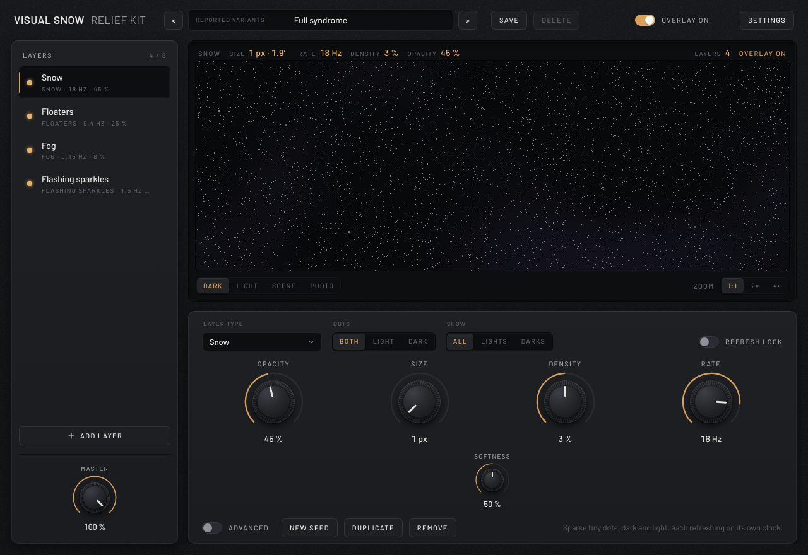

The panel follows a studio-hardware design: a dark matte faceplate, raised plates, a recessed display, one amber accent and large dials.

| Area | What it does |
|---|---|
| **Header** | Step through presets with the arrows, or click the name to open the preset gallery. Save and Delete work on your own presets. The Overlay switch turns the overlay on or off on every screen. |
| **Layers plate** | Up to eight stacked layers. The amber light shows a layer is on; click it to hide the layer. Drag to reorder. Double-click a name to rename it. The Master dial sets the strength of all layers together. |
| **Display** | Live preview with readouts: size in pixels and arcminutes of visual angle, rate in hertz, density and opacity. Switch the background between dark, light, a desktop scene or your own photo. |
| **Layer plate** | Layer type, which dots to draw, and which parts to show along the top. Four large dials for the main settings, then small dials for the settings that belong to that type. |
| **Advanced plate** | Tint colour, mask area, variation over time and a daily schedule, with dials for tint, drift, mask and variation. |

### On a desktop scene

The Scene background shows the noise over a window of text, the way it will look over your own apps.

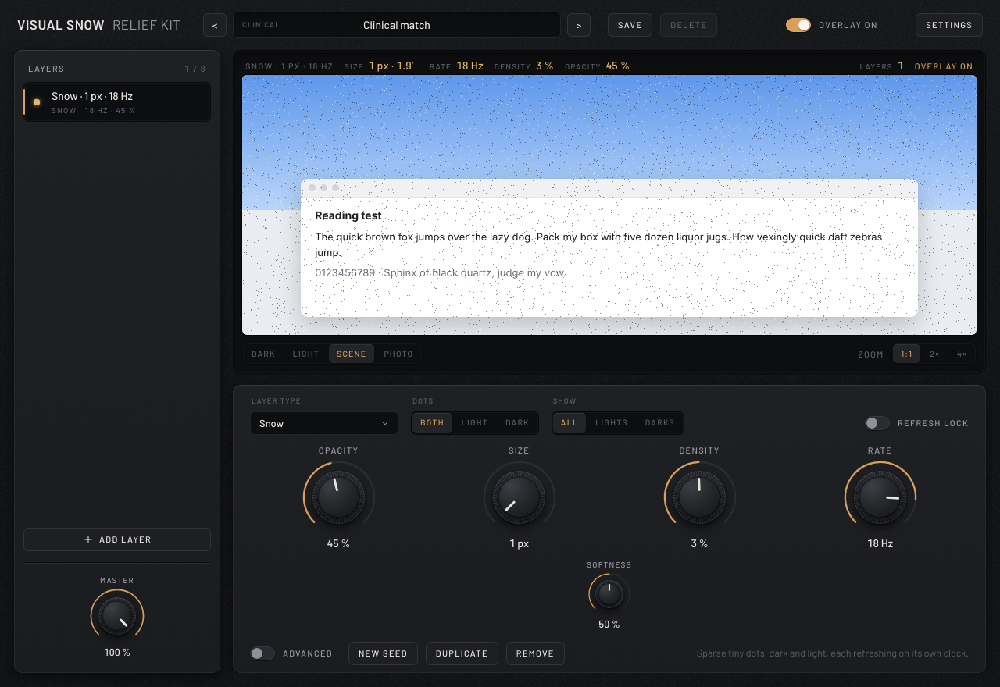

### On a light screen

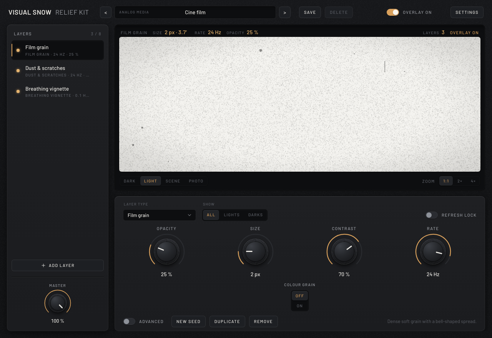

### Eyes-closed preset

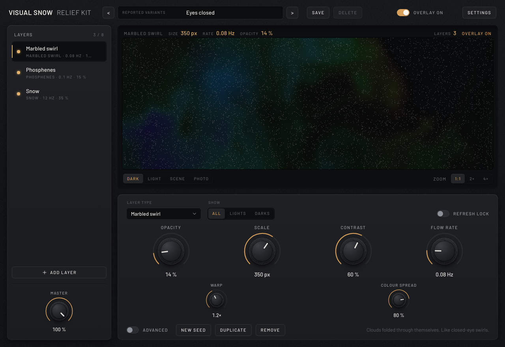

### Advanced plate

Here a snow layer is masked to the edges of the screen, so it is heavier in peripheral vision, and its density rises and falls over a 45-second cycle.

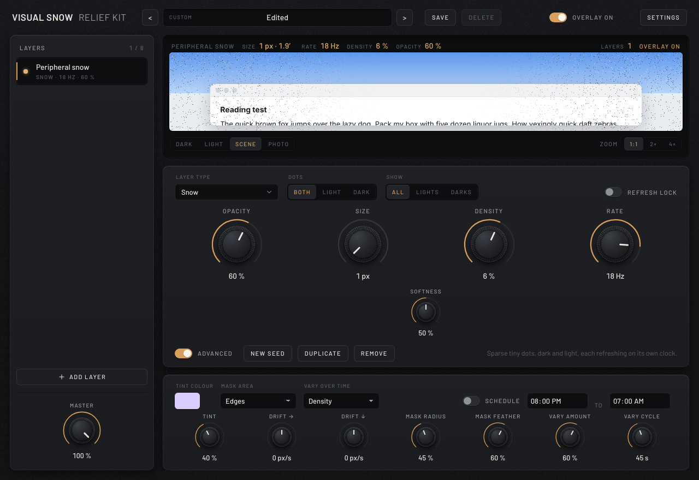

### Zoom

1:1 shows real screen pixels. 2× and 4× enlarge the preview so single-pixel dots can be inspected.

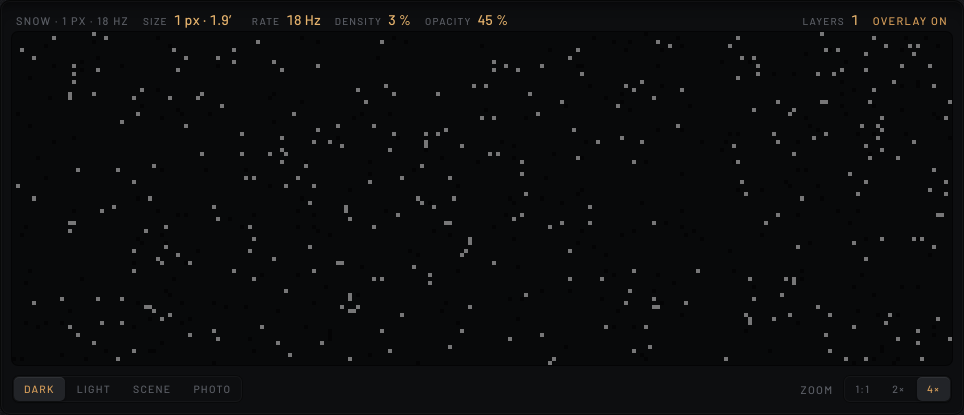

### Layer menu

Right-click a layer to rename, change its type, duplicate, hide or remove it.

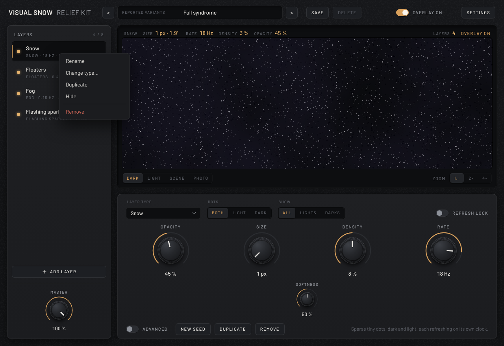

### Dials

| Action | Result |
|---|---|
| Drag up or down | Change the value |
| Shift and drag | Fine control |
| Scroll wheel | Small steps |
| Arrow keys | 1 % steps; Shift for 10 % |
| Home, End | Minimum, maximum |
| Double-click dial or label | Reset to the default |
| Click the value | Type an exact value |

---

## Noise types

37 types in six families. In every tile below, the left half shows the layer on a dark screen and the right half on a light screen. Some types are drawn with light parts only or dark parts only, so they show on one half; the Dots selector changes that.

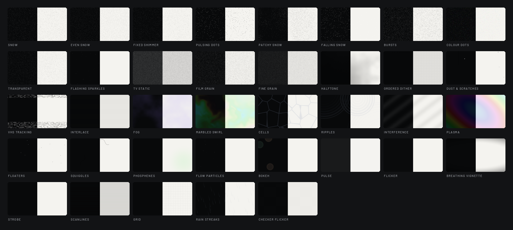

### Dots: the visual snow core

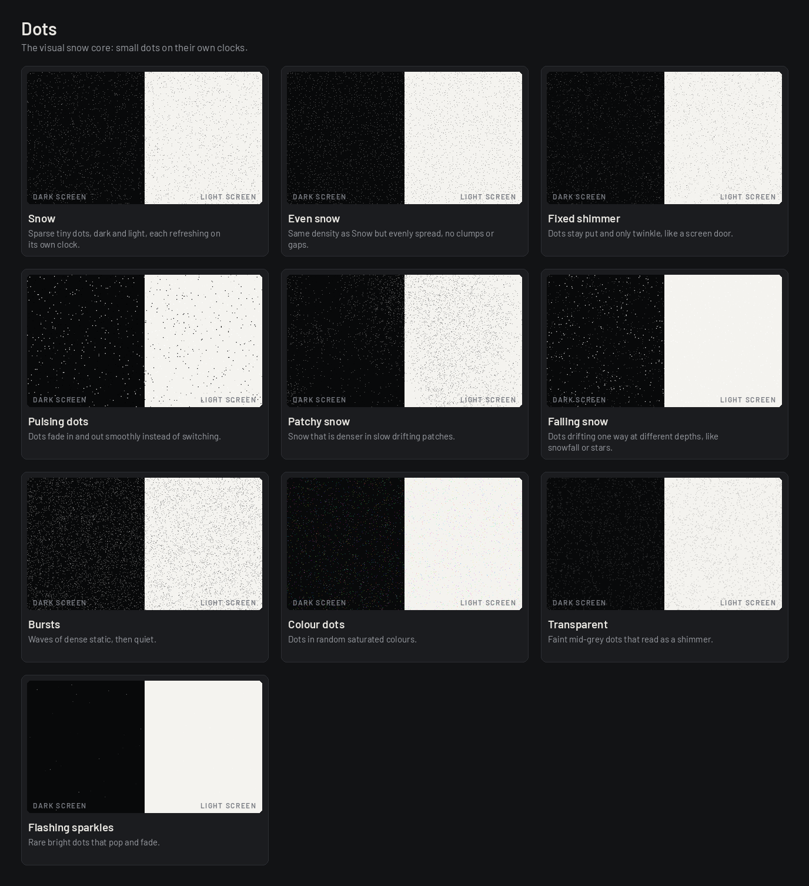

| Type | Looks like |
|---|---|
| [Snow](images/types/snow.png) | Sparse tiny dots, dark and light, each refreshing on its own clock. |
| [Even snow](images/types/even.png) | Same density as Snow but evenly spread, no clumps or gaps. |
| [Fixed shimmer](images/types/fixed.png) | Dots stay put and only twinkle, like a screen door. |
| [Pulsing dots](images/types/pulsedots.png) | Dots fade in and out smoothly instead of switching. |
| [Patchy snow](images/types/patchy.png) | Snow that is denser in slow drifting patches. |
| [Falling snow](images/types/falling.png) | Dots drifting one way at different depths, like snowfall or stars. |
| [Bursts](images/types/burst.png) | Waves of dense static, then quiet. |
| [Colour dots](images/types/chroma.png) | Dots in random saturated colours. |
| [Transparent](images/types/shimmer.png) | Faint mid-grey dots that read as a shimmer. |
| [Flashing sparkles](images/types/sparkle.png) | Rare bright dots that pop and fade. |

### Grain and static

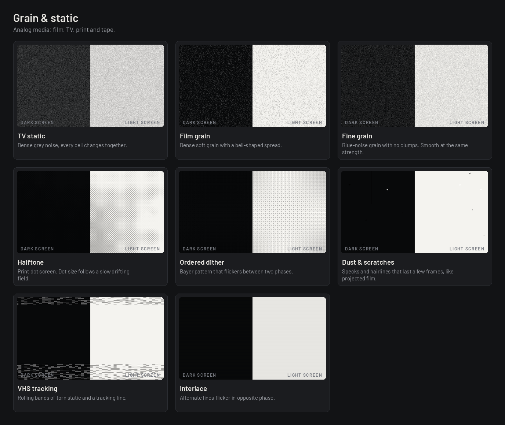

| Type | Looks like |
|---|---|
| [TV static](images/types/static.png) | Dense grey noise, every cell changes together. |
| [Film grain](images/types/grain.png) | Soft grain with a bell-shaped spread, mono or colour. |
| [Fine grain](images/types/bluegrain.png) | Blue-noise grain with no clumps. Smooth at the same strength. |
| [Halftone](images/types/halftone.png) | Print dot screen. Dot size follows a slow drifting field. |
| [Ordered dither](images/types/dither.png) | Bayer pattern that flickers between two phases. |
| Dust and scratches | Specks and hairlines that last a few frames, like projected film. |
| [VHS tracking](images/types/vhs.png) | Rolling bands of torn static and a tracking line. |
| [Interlace](images/types/interlace.png) | Alternate lines flicker in opposite phase. |

### Fields

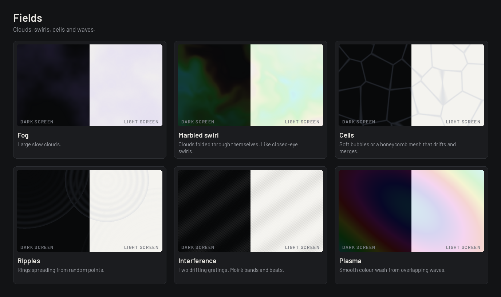

| Type | Looks like |
|---|---|
| [Fog](images/types/fog.png) | Large slow clouds. |
| [Marbled swirl](images/types/warp.png) | Clouds folded through themselves. Like closed-eye swirls. |
| [Cells](images/types/cells.png) | Soft bubbles or a honeycomb mesh that drifts and merges. |
| [Ripples](images/types/ripples.png) | Rings spreading from random points. |
| [Interference](images/types/interference.png) | Two drifting gratings. Moiré bands and beats. |
| [Plasma](images/types/plasma.png) | Smooth colour wash from overlapping waves. |

### Floaters and shapes

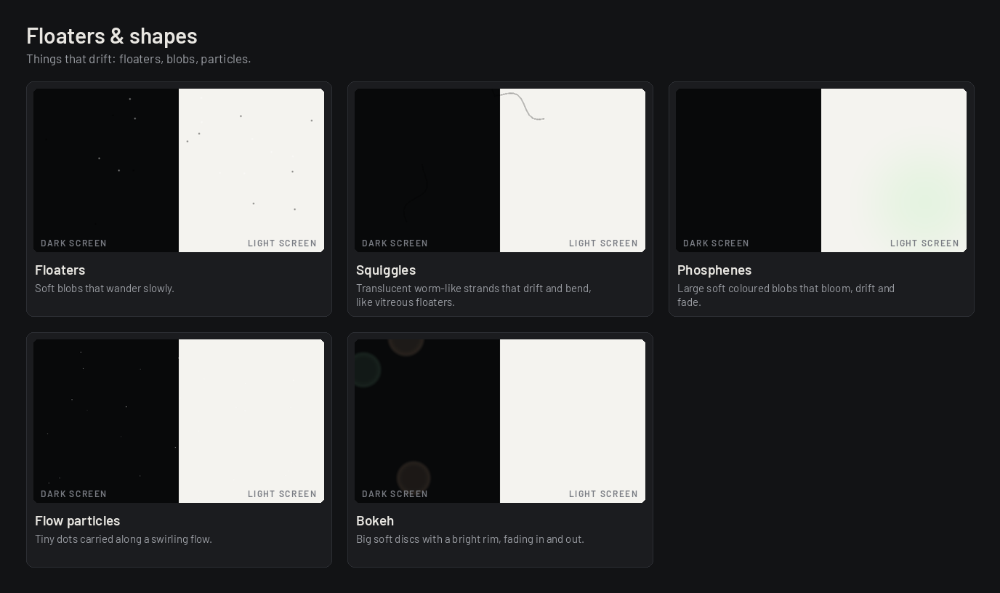

| Type | Looks like |
|---|---|
| [Floaters](images/types/floaters.png) | Soft blobs that wander slowly. |
| [Squiggles](images/types/squiggles.png) | Translucent worm-like strands that drift and bend, like vitreous floaters. |
| [Phosphenes](images/types/phosphene.png) | Large soft coloured blobs that bloom, drift and fade. |
| [Flow particles](images/types/flow.png) | Tiny dots carried along a swirling flow. |
| [Bokeh](images/types/bokeh.png) | Big soft discs with a bright rim, fading in and out. |

### Flicker

Whole-screen brightness changes. These are held to 3 flashes a second unless you allow faster flicker in Settings. A single frame cannot show flicker, so these tiles show one moment of it.

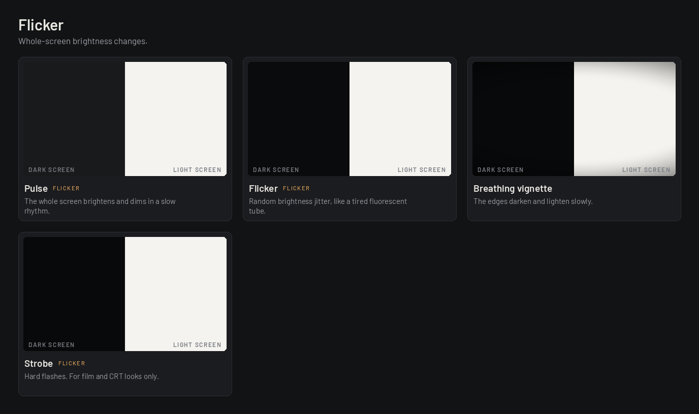

| Type | Looks like |
|---|---|
| [Pulse](images/types/pulse.png) | The whole screen brightens and dims in a slow rhythm. |
| [Flicker](images/types/flicker.png) | Random brightness jitter, like a tired fluorescent tube. |
| [Breathing vignette](images/types/vignette.png) | The edges darken and lighten slowly. |
| [Strobe](images/types/strobe.png) | Hard flashes. For film and CRT looks only. |

### Lines and structure

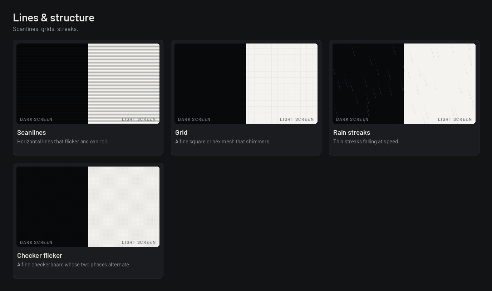

| Type | Looks like |
|---|---|
| [Scanlines](images/types/scanlines.png) | Horizontal lines that flicker and can roll. |
| [Grid](images/types/grid.png) | A fine square or hex mesh that shimmers. |
| [Rain streaks](images/types/rain.png) | Thin streaks falling at speed. |
| [Checker flicker](images/types/checker.png) | A fine checkerboard whose two phases alternate. |

---

## Layer features

Every layer, whatever its type, has these controls.

| Feature | What it does |
|---|---|
| Opacity, size, density, contrast, softness, rate | The main dials. Each type shows only the ones it uses. |
| Pattern settings | Settings that belong to one type, such as patch scale for Patchy snow or ring spacing for Ripples. |
| Dots | Draw both light and dark dots, light only, or dark only. |
| Show | All, lights only, or darks only. Lights only shows on dark parts of the screen, darks only on light parts. |
| Tint | A colour and how much of it to apply. |
| Drift | Constant motion to the right or down, in pixels per second. |
| Mask | Full screen, centre, edges, left, right, top or bottom, with size and feather. Edges suits snow that is worse in peripheral vision. Centre clear keeps a reading area clean. |
| Vary over time | Slowly raises and lowers opacity, density or rate over a cycle of 5 seconds to 15 minutes. |
| Schedule | Shows the layer only between two times of day. |
| Refresh lock | Snaps the rate to an even divisor of your display refresh, which removes beating. |
| New seed | A new random pattern with the same settings. |

---

## Presets

28 built-in presets in five groups. Save your own, and export or import them as JSON to share with others. Click a preset name for its full-size image.

| Preset | Group | Layers |
|---|---|---|
| [Clinical match](images/presets/clinical.png) | Clinical | Snow |
| [Clinical, even texture](images/presets/clinical-even.png) | Clinical | Even snow |
| [Clinical, strong](images/presets/clinical-strong.png) | Clinical | Snow, Snow |
| [Worse at the edges](images/presets/clinical-periphery.png) | Clinical | Snow, Snow |
| [Black and white](images/presets/bw.png) | Reported variants | TV static, Snow |
| [Transparent](images/presets/transparent.png) | Reported variants | Transparent |
| [Flashing](images/presets/flashing.png) | Reported variants | Snow, Flashing sparkles |
| [Coloured](images/presets/coloured.png) | Reported variants | Snow, Colour dots |
| [Screen door](images/presets/screen-door.png) | Reported variants | Fixed shimmer |
| [Waves of static](images/presets/waves.png) | Reported variants | Bursts, Patchy snow |
| [Bright sky](images/presets/bright-sky.png) | Reported variants | Snow, Squiggles, Floaters |
| [Eyes closed](images/presets/eyes-closed.png) | Reported variants | Marbled swirl, Phosphenes, Snow |
| [Dim room](images/presets/dim-room.png) | Reported variants | Snow, Fog |
| [Full syndrome](images/presets/full.png) | Reported variants | Snow, Floaters, Fog, Flashing sparkles |
| [Cine film](images/presets/film.png) | Analog media | Film grain, Dust & scratches, Breathing vignette |
| [Old CRT](images/presets/crt.png) | Analog media | TV static, Scanlines, Pulse |
| [VHS tape](images/presets/vhs.png) | Analog media | VHS tracking, Interlace, TV static |
| [Newsprint](images/presets/print.png) | Analog media | Halftone, Fine grain |
| [1-bit dither](images/presets/dither.png) | Analog media | Ordered dither |
| [Soft grain](images/presets/soft-grain.png) | Ambient & calm | Fine grain |
| [Snowfall](images/presets/snowfall.png) | Ambient & calm | Falling snow |
| [Drift](images/presets/drift.png) | Ambient & calm | Flow particles, Fog |
| [Night lights](images/presets/night-lights.png) | Ambient & calm | Bokeh |
| [Dead channel](images/presets/tv.png) | Demo & extreme | TV static |
| [Big pixel mosaic](images/presets/mosaic.png) | Demo & extreme | TV static |
| [Moiré](images/presets/moire.png) | Demo & extreme | Interference |
| [Plasma](images/presets/plasma.png) | Demo & extreme | Plasma, Ripples |
| [Storm](images/presets/storm.png) | Demo & extreme | Rain streaks, Fog, Flicker |

### Clinical

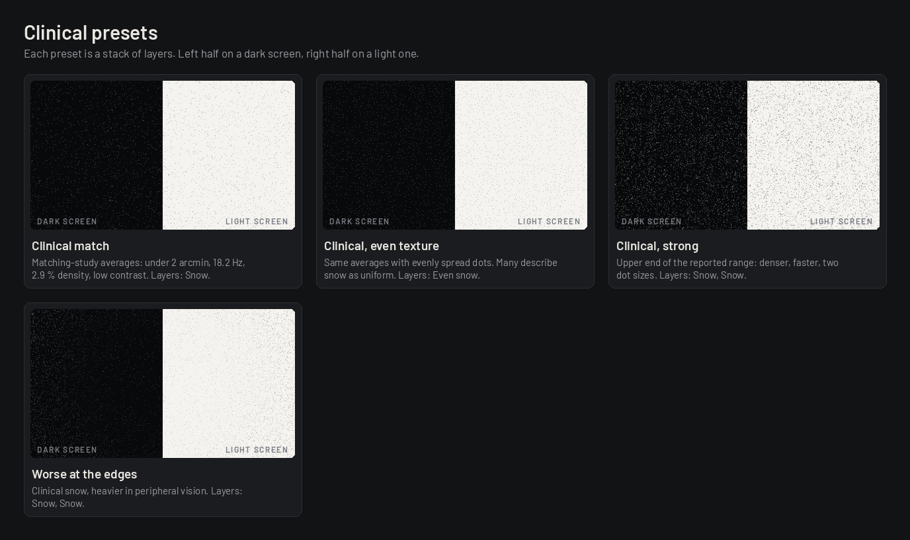

### Reported variants

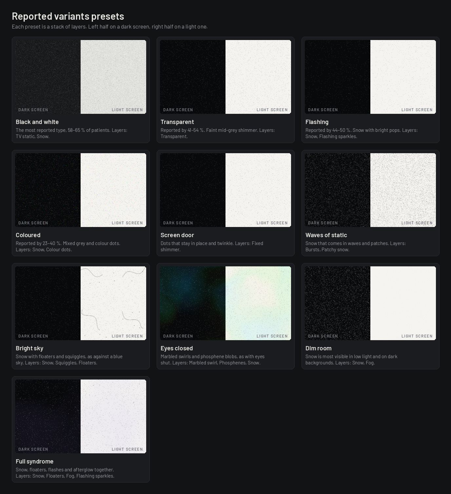

### Analog media

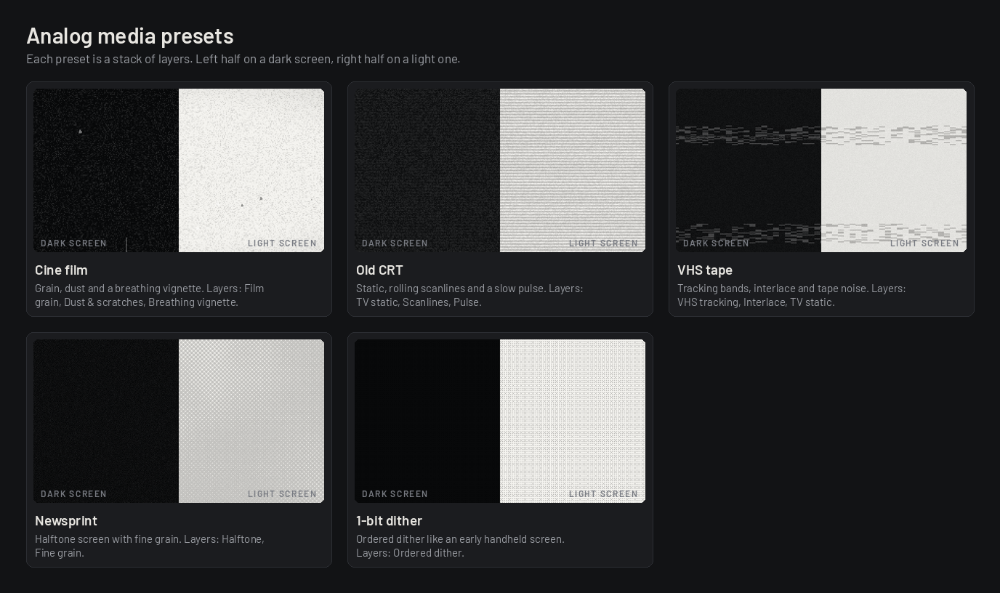

### Ambient and calm

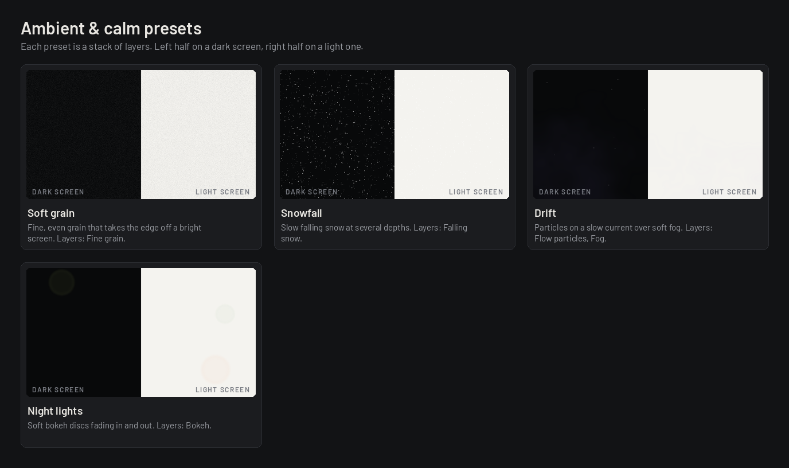

### Demo and extreme

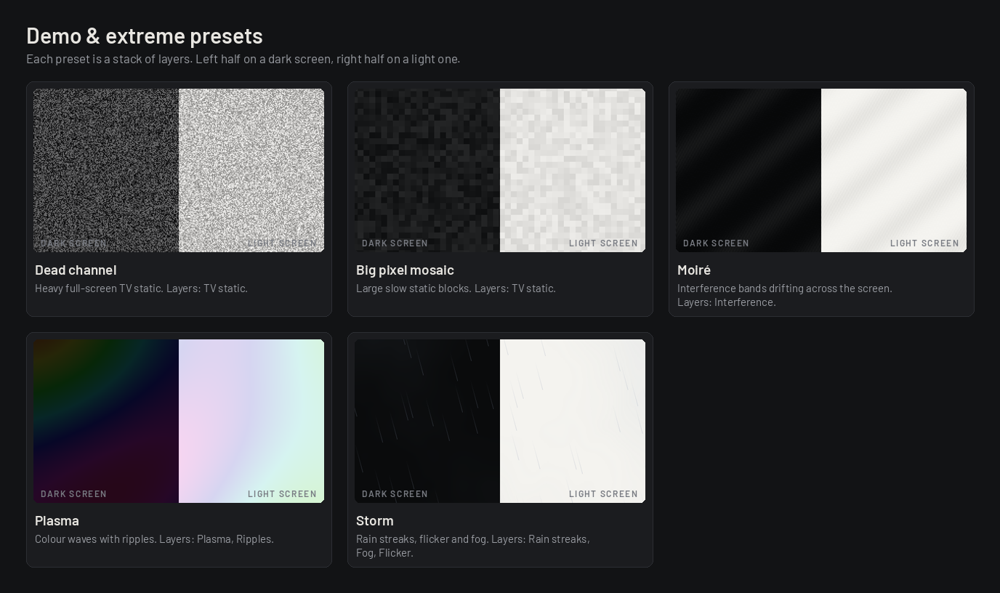

---

## Galleries

### Type gallery

Opens from Add layer or from the layer type selector. Every card is a live thumbnail drawn by the same renderer as the overlay. Filter by family along the top.

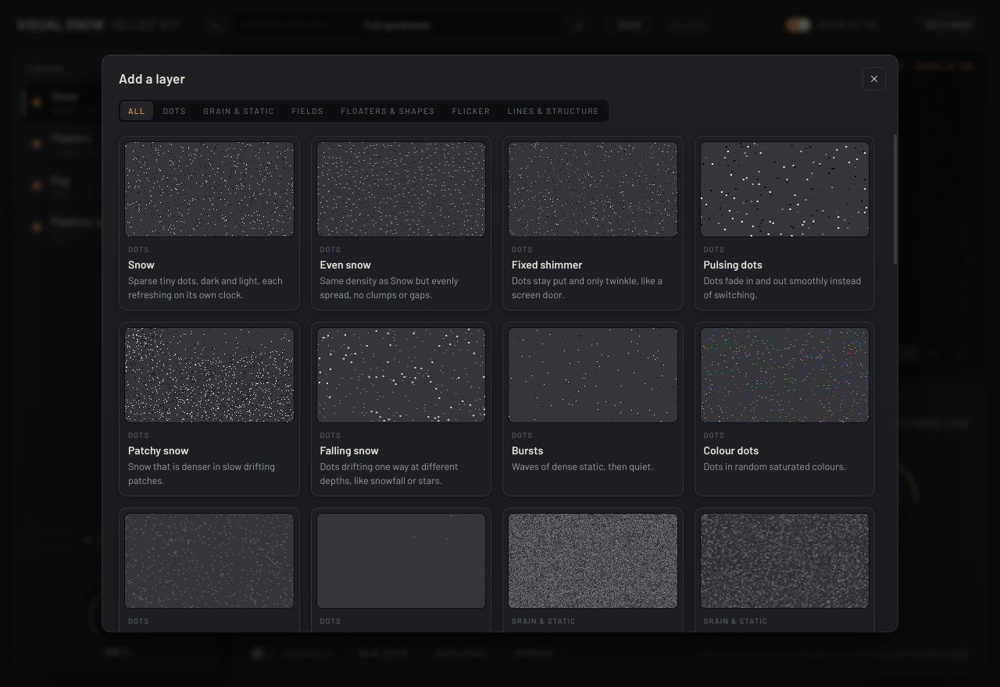

| Family filter | Image |
|---|---|
| Dots | [gallery-dots.png](images/gallery-dots.png) |
| Grain and static | [gallery-grain.png](images/gallery-grain.png) |
| Fields | [gallery-fields.png](images/gallery-fields.png) |
| Floaters and shapes | [gallery-shapes.png](images/gallery-shapes.png) |
| Flicker | [gallery-flicker.png](images/gallery-flicker.png) |
| Lines and structure | [gallery-lines.png](images/gallery-lines.png) |

### Preset gallery

Opens from the preset name in the header. Your own presets appear first.

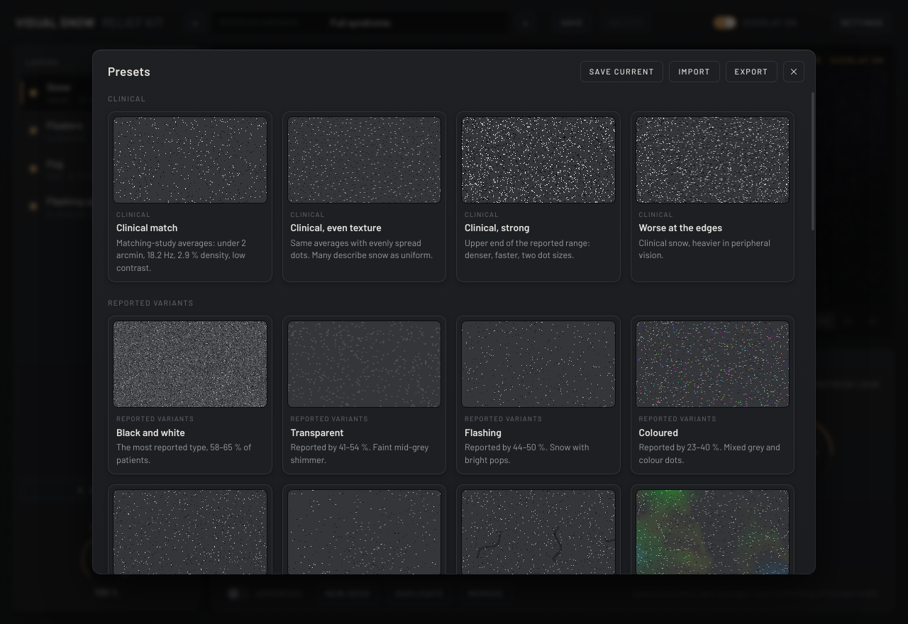

---

## Settings

| Tab | What it holds |
|---|---|
| General | Frame rate cap, keep on top, start at login. |
| Displays | Which screens show the overlay. |
| Hotkeys | Press the keys to record a new shortcut. Shows a warning if another app holds it. |
| Calibration | Screen size and viewing distance, for arcminute readouts. |
| Safety | Allow full-screen flicker above 3 Hz, and show the welcome screen again. |
| About | Version, settings file location, licence and links. |

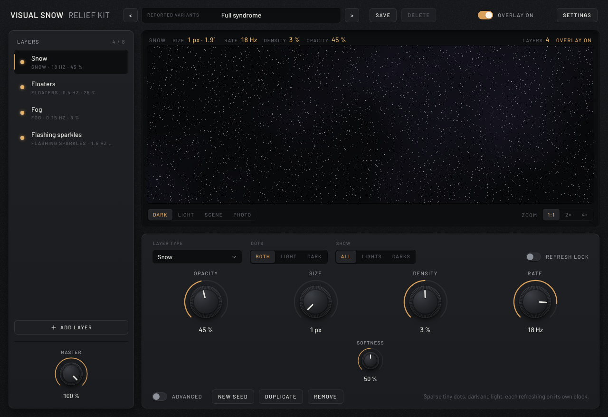

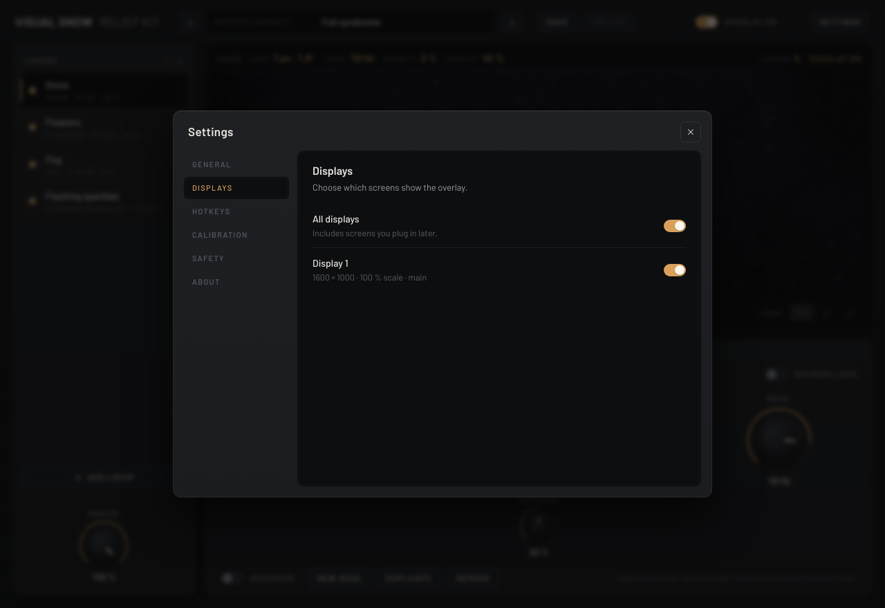

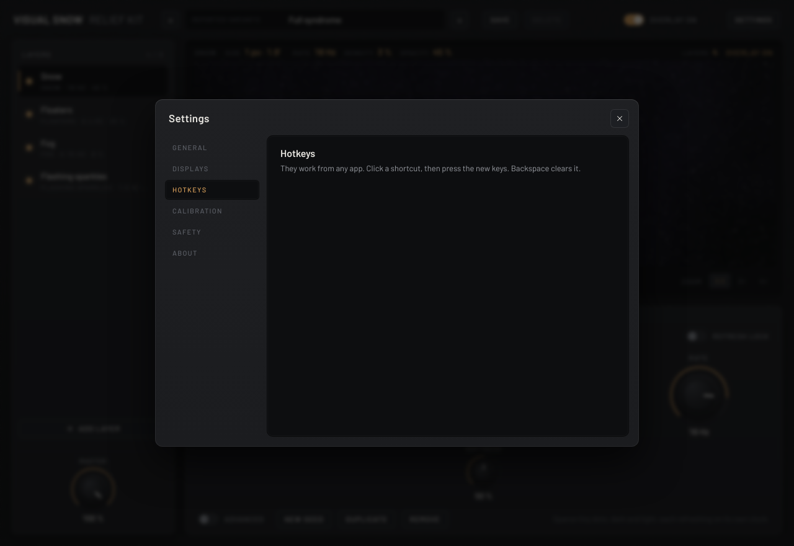

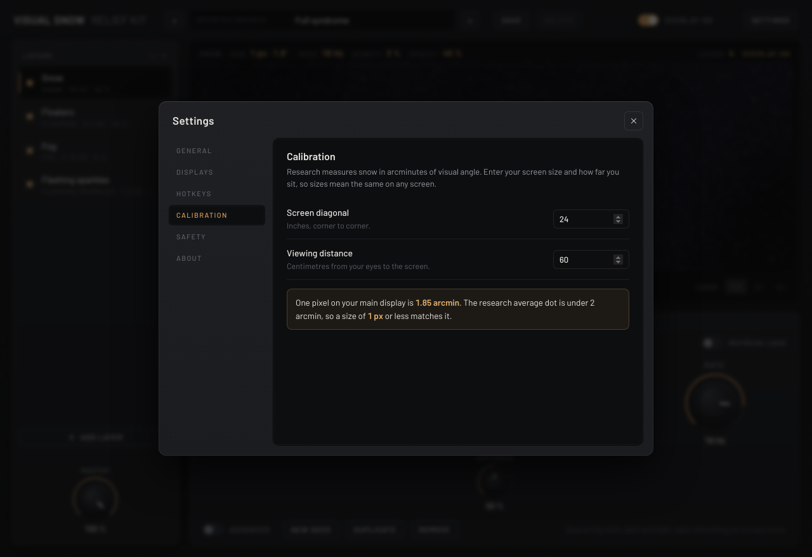

Also captured: [Displays](images/settings-displays.png) · [About](images/settings-about.png)

### First run

The first start shows what the app does, the two hotkeys and the flicker warning.

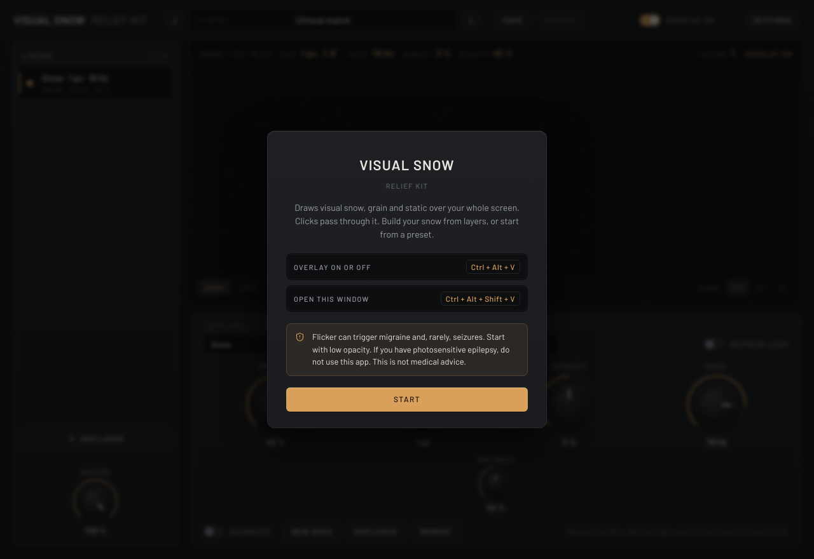

---

## Research defaults and calibration

The defaults come from studies that asked people with visual snow syndrome to tune a simulation until it matched what they see.

| Property | Finding | Default |
|---|---|---|
| Dot size | Under 2 arcminutes of visual angle. The most consistent property between people. | 1 screen pixel |
| Refresh rate | Mean 18.2 Hz, with wide spread between people. | 18 Hz |
| Density | About 2.9 % of the field is a dot at any instant. | 3 % |
| Contrast | Very low, about 2.6 % RMS. | 45 % opacity on 1 px dots |
| Colour | Black and white most common (58–65 % of patients), then transparent (41–54 %), flashing (44–50 %), coloured (23–40 %). | Mixed light and dark dots; the other kinds are presets |

The Calibration tab converts pixels to arcminutes for your screen and viewing distance. The display readout and the Size dial show the result, so settings mean the same on any screen.

Sources are listed in the [README](../README.md#what-the-research-says-and-how-it-set-the-defaults) and in [PRD.md](../PRD.md).

---

## Safety

- Pulse, Flicker and Strobe are held to 3 flashes a second, the level the WCAG 2.3.1 accessibility guideline warns about. Flicker may go faster only at 10 % depth or less. The cap includes rate variation.
- The cap can be lifted in Settings, Safety, after a warning.
- Adding a Strobe layer asks first. No built-in preset uses Strobe.
- Gallery thumbnails of flicker types are drawn still.
- If you have photosensitive epilepsy, do not use this app. Nothing here is medical advice.

---

## How it runs

| Topic | Detail |
|---|---|
| Overlay | One transparent, click-through, always-on-top window per screen. It re-asserts its place on top every second. |
| Rendering | WebGL 2. All layers draw in one pass. The renderer compiles a small shader holding only the types in use, so cost stays flat as the catalog grows. |
| Frame rate | Each layer changes at its own rate in hertz. The renderer skips frames when nothing would change, so 18 Hz snow draws far fewer frames than the screen refresh rate. |
| Portability | Unzip and run on Windows, macOS (Intel and Apple Silicon) or Linux. Settings stay next to the app when its folder is writable. |
| Hotkeys | Ctrl+Alt+V toggles the overlay. Ctrl+Alt+Shift+V opens the panel. On macOS, Cmd replaces Ctrl. |
| Licence | Apache 2.0. Free to use, change and share. |

### Regenerating these images

```
VS_DOCS=/tmp/vs-docs npx electron .
python3 scripts/doc-sheets.py /tmp/vs-docs docs/images
```

On Linux without a display, prefix the first command with `xvfb-run -a`.
